# Run the ACM demo — console and terminal

**Duration:** allow 75–90 minutes, including time for the new cluster-set and policy exercise.
Operator installation and compliance scans run asynchronously; prepare to show their progress
and return to results later rather than waiting for completion.
**Story:** introduce the ACM hub and its interfaces, explore cluster lifecycle, organise the
fleet, apply governance, and deliver an application to selected clusters.

This is a presenter guide. Each act explains the idea first; each step tells you where to go,
what to point out, what to say, and which terminal commands to run. Screenshots show examples
of the expected views; the live console is the source of truth. Resource names and results can
differ in another environment.

### The story in one minute

> “Teams often operate clusters in several locations: a central data centre, a public cloud,
> and smaller sites close to users or equipment. Creating each cluster by hand and checking
> its configuration separately becomes difficult as the number grows. Red Hat Advanced Cluster
> Management, or ACM, gives us a central place to manage the fleet. We will look at cluster
> lifecycle, cluster sets, governance, and application delivery. Along the way we will trace a
> prebuilt site, enforce a common baseline, and compare application delivery models.”

The **hub** is the cluster where ACM runs. A **managed cluster** is a cluster registered with
the hub. The hub is also registered as `local-cluster`; the other three are the demonstration
targets: `cluster1`, `cluster2-sno`, and `ztp-sno`. A **desired state** describes what should
exist; a controller compares it with the actual state and, when configured to do so, acts on
the difference. A **placement** selects the managed clusters that should receive a policy or
application, often using labels.

**Use the precreated clusters and existing ignored local values.** Do not provision another
cluster or restart ZTP during this presentation. Lifecycle and ZTP are an explanation of what
was created before the session—not a live install. The governance exercise does request a
Compliance Operator installation on the selected managed clusters.

## Before the audience arrives

### 1. Initialize the presentation shell

From the repository root, use Bash:

```bash
cd acm-demos
source scripts/demo-shell.sh
scripts/verify.sh
```

The initializer loads trusted ignored `config/demo.env`, prompts for missing variables, and
sets connection/resource names. `verify.sh` checks the existing fleet read-only. Keep this same
shell throughout the presentation; do not change global kubeconfig context.

| Helper | Where its commands run |
| --- | --- |
| `oc_hub` | ACM hub: fleet, policies, SiteConfig, application intent |
| `oc_prod` | Precreated production cluster: baseline and subscription/push workloads |
| `oc_ztp` | Installed precreated ZTP cluster: guest node and operator health |
| `oc_agent` | Precreated agent target: local Application/controller and app workload |
| `oc_excluded` | Prepared negative target: prove production policy did not affect it |

These helpers include the selected context, optional private kubeconfig path, and request timeout.
A variable such as `$ZTP_CLUSTER` identifies the prepared resource; it is not an instruction
to create a new cluster.

### 2. Reuse the precreated values files

`$DEMO_VALUES_DIR` defaults to `values/`. This runbook uses:

| Existing local file | Used for |
| --- | --- |
| `ztp-site.local.yaml`, `ztp-target.local.yaml` | Explain the inputs that created the site and VM; **do not apply** |
| `governance-inform.local.yaml` | Inform baseline and post-demo restoration |
| `governance-enforce.local.yaml` | Change the same policy intent to enforce |
| `subscription.local.yaml` | Subscription delivery intent and v1 baseline |
| `push.local.yaml` | Central Argo delivery intent and v1 baseline |
| `agent.local.yaml` | Agent delivery intent and v1 baseline |
| `app-v2.local.yaml` | The prepared application version for the three updates |

Do not copy examples over these files or create a new environment configuration for the talk.
Do not display entire private values files: show only reviewed non-secret fields/diffs.

Prepare the v2 version and an explicit hub Helm command in this shell:

```bash
DEMO_V2_VERSION=$(ruby -ryaml -e 'puts YAML.load_file(ARGV[0]).fetch("version")' \
  "$DEMO_VALUES_DIR/app-v2.local.yaml")
SUB_V2_CHART_VERSION=0.2.0
HELM_HUB=(helm --kube-context "$HUB_CONTEXT")
if [[ -n ${HUB_KUBECONFIG:-} ]]; then
  HELM_HUB+=(--kubeconfig "$HUB_KUBECONFIG")
fi
```

`SUB_V2_CHART_VERSION` must match the **already published** v2 package in the prepared Helm
repository; confirm/change it backstage if your package version differs. Chart package version
and displayed app version are separate fields. The one-field `app-v2.local.yaml` belongs to the
app chart's values shape: do **not** pass it directly as a delivery-chart overlay. The update
commands below map its version to the delivery chart's `application.version` explicitly.

**Ownership rule:** the shown update commands are for the existing **CLI Helm-owned intent
releases**. If Git/Argo owns those intent resources, use that owner's rehearsed values/revision
change instead; do not introduce a second owner. A chart fetched from Git does not mean that
CLI Helm release updates themselves are automatically Git-reconciled.

### 3. Confirm starting states

- [ ] Existing production, QA, and ZTP clusters are available; guest node/operator checks pass.
- [ ] The ZTP site is already installed. Site values and retained generated resources are available.
- [ ] Governance starts inform / NonCompliant, with an absent or incorrect harmless baseline.
- [ ] Subscription, push, and agent apps are at v1 and their actual HTTPS pages work.
- [ ] v2 chart package is published; local version input is prepared; no publishing during the talk.
- [ ] Principal/agent connection, local-controller permissions, and isolated instances are ready.
- [ ] Actual Subscription Deployment/Route names and local/principal Application names are set.
- [ ] Policy/drift/app updates are authorized; v1/inform restoration is agreed for afterward.
- [ ] Record the original cluster-set memberships and review existing placements that may
      change if the three managed clusters move to `demo-compliance`. Confirm the existing
      governance and application placements will still select their intended clusters.
- [ ] Check that the three clusters have storage, resources and catalog access for the
      Compliance Operator and its scan; confirm existing compliance installations and ownership.
- [ ] The `demo-compliance` set and `acm-demo-compliance` namespace are available for this
      exercise, or use agreed unique names consistently in the example manifests.

If those states need restoring, do it before starting the clock using [setup](setup.md) and
[reset](reset.md), not by creating clusters during the presentation.

Before changing cluster-set membership, save a private record and inspect it:

```bash
mkdir -p private
oc_hub get managedclusters -o json | jq '[.items[] | {
  name: .metadata.name,
  clusterSet: .metadata.labels["cluster.open-cluster-management.io/clusterset"]
}]' > private/cluster-sets-before.json
cat private/cluster-sets-before.json
oc_hub get placements,placementdecisions -A
```

Also record existing Compliance Operator resources and scan storage on all three targets,
including any existing `openshift-compliance` namespace, subscriptions, CSVs, operator groups,
bindings, and PVCs. The `private/` directory is ignored by Git. Review whether changing set
membership changes any existing policy or application decision before starting the demo.

### 4. Open the browser tabs

1. **ACM:** All Clusters → Infrastructure → Clusters.
   Keep the **Cluster sets** tab available for the fleet organisation section.
2. **Virtualization:** hub cluster → VirtualMachines, project `$ZTP_CLUSTER`, VM `$ZTP_VM`.
3. **Governance:** Policies, namespace `$POLICY_NS`, policy `$GOVERNANCE_RELEASE`.
4. **Subscription:** ACM Applications, `$SUB_RELEASE` in `$SUB_NS`, topology view.
5. **Central Argo CD:** Application `$PUSH_APP` in the central instance.
6. **Agent principal Argo CD:** Application `$AGENT_APP` in the separate principal instance.
7. The three real application pages; optional reviewed source/values comparison in Git.

The agent principal has its **own Argo CD console**, separate from the central push console.
Find its URL on the hub, then sign in with OpenShift SSO:

```bash
oc_hub get route agent-principal-server -n "$PRINCIPAL_NS" \
  -o jsonpath='https://{.spec.host}{"\n"}'
```

Open the `agent-principal-server` route for the UI, not the similarly named agent-connection
route. The central `openshift-gitops` console shows the push Applications; the agent Application
appears in the separate principal console.

Authenticate before sharing the screen. If the application routes use a default ingress certificate, configure the presenter browser to trust that cluster CA before the talk. Application screenshots were captured with certificate verification disabled for this lab. Menu names vary slightly by installed console version.
Never show Secret pages, kubeconfigs, BMC passwords, signed ISO URLs, ignition, or unfiltered
authentication/installer logs.

## Presentation running order

| Time | What we show | What we explain |
| --- | --- | --- |
| 00–04 | ACM console and CLI | Hub, managed clusters, API and declarative management |
| 04–16 | Lifecycle and the precreated ZTP site | MCE, standalone and hosted clusters, providers and ZTP |
| 16–24 | Create the cluster set in the console | Grouping, namespace bindings and selecting targets |
| 24–43 | Governance and Compliance Operator policies | Inform, enforce, drift correction and scan setup |
| 43–50 | Application models and subscription topology | Push, pull and agent; legacy subscription example |
| 50–59 | Central Argo tree + remote rollout | Central push reconciliation |
| 59–69 | Principal + local Application/controller + app | Agent delivery and local reconciliation |
| 69–72 | Fleet recap + comparison | Which control loop runs where, and why that matters |
| 72–90 | Buffer, questions, and revisit scan progress | Installation and scan duration depend on the environment |

**Surface cues:** CONSOLE = navigate and highlight; TERMINAL = run the commands shown; APP =
show the actual HTTPS page; ADVANCE = make the described policy or application change. A step
can use more than one surface. Everything else is observation; cluster creation is not part of
the presentation.

## Pillar 1 — ACM architecture and management interfaces · 00:00–04:00

ACM runs on a **hub cluster**. Managed clusters register with the hub and run a klusterlet
and, where enabled, add-ons that support functions such as governance and application
management. The hub provides a central view and coordinates work across the fleet; the
managed clusters remain separate clusters with their own workloads and APIs.

You can work through the **console**, use the **Kubernetes API**, or use a CLI such as `oc`
to read and change API resources. These are different ways to interact with the same platform.
For declarative management, describe the desired state as API resources and apply it through a
tool such as Helm or GitOps; controllers then reconcile that state. The CLI can both inspect
and change resources, so it is not limited to declarative operations. The exercises below use
the console to explain the result and the terminal to inspect or change specific resources.

**Say:** “Think of the hub as the fleet's management centre. We can use its console for a
visual overview or use the API and CLI for automation and repeatable configuration. Agents
and add-ons on managed clusters help connect the central view to the work at each cluster.”

### Step 1 — CONSOLE: show the prepared fleet

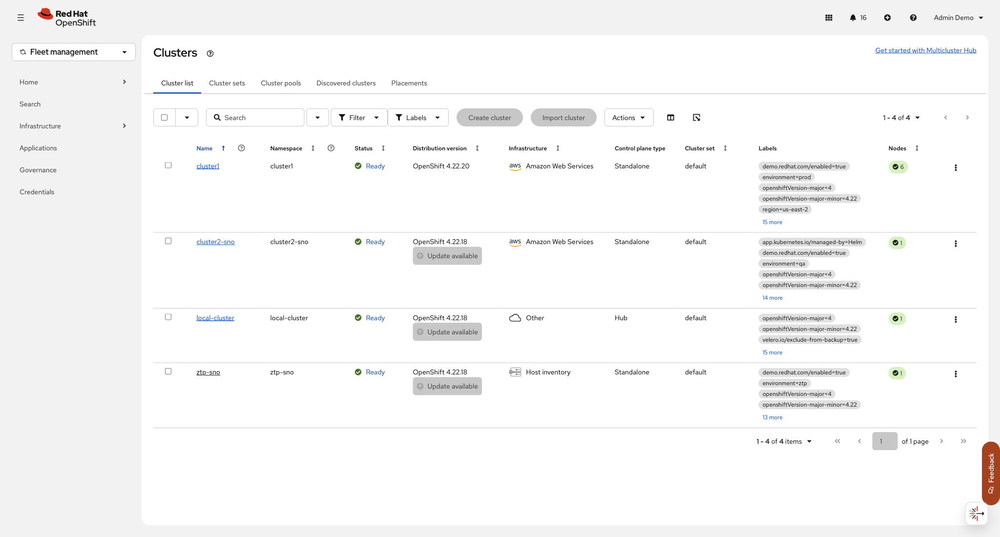

**Show:** Fleet management → Infrastructure → Clusters; point to the three precreated Ready managed clusters.

All Clusters → Infrastructure → Clusters. Point to the hub/local cluster, production target,
agent target, and precreated ZTP site. Open production Overview: availability, version, labels.

**Say:** “The hub gives us one view of our clusters. `cluster1` is our production example,
`cluster2-sno` is a single-node QA example, and `ztp-sno` represents a small remote site.
The clusters already exist, so we can focus on how we manage them. Labels let us select the
right clusters for a particular policy or application.”

**Why this matters:** The audience can see the different environments together before learning
how one central definition can be applied to a selected group. Ready means ACM reports the
cluster available; it does not by itself prove that every application is healthy.

### Step 2 — TERMINAL: anchor the UI in actual APIs

```bash
oc_hub get clusterversion version
oc_hub get multiclusterhub -A
oc_hub get managedclusters
```

**Point:** hub version/ACM and accepted/available remote clusters. The local-cluster registration
is the hub itself, not another remote target. Helm is the shared rendering/definition format;
SiteConfig, policy controllers, subscription machinery, and Argo have different responsibilities.

**Transition:** “Start with the completed site and trace how it became a managed cluster.”

## Pillar 2 — cluster lifecycle and ZTP · 04:00–16:00

### Background for the presenter

The **multicluster engine for Kubernetes (MCE)** provides cluster lifecycle capabilities used
by ACM. Depending on the platform and configuration, teams can create or import clusters,
observe them, and manage lifecycle operations such as upgrades. ACM can manage environments
across public cloud and on-premises infrastructure; supported operations and prerequisites vary
by provider and release. For example, cloud provisioning and host-inventory provisioning use
different infrastructure integrations.

A **standalone cluster** has its control plane as part of that cluster. A **hosted cluster**
has its control plane hosted on a separate management/hosting cluster, while its workloads run
on its worker nodes. Hosted control planes can change the resource and operational model when
many clusters are needed. Neither architecture is universally the right choice: infrastructure,
support, isolation, availability and operational requirements matter.

**Say:** “MCE gives ACM its cluster lifecycle capabilities. We can manage clusters across
different infrastructures, including standalone clusters and hosted control planes. The
clusters in this demonstration are standalone; we will explain hosted clusters as an option,
not show a hosted cluster installation.”

Zero Touch Provisioning (ZTP) is an approach to provisioning sites from repeatable definitions
and automation, reducing the need to configure each site by hand. It is useful when many
similar clusters are needed at remote locations, such as shops, factories, or edge sites.
The practical benefits are a more consistent starting point, repeatable changes, and a clearer
record of the intended configuration. It still needs suitable infrastructure, connectivity,
DNS, credentials, and preparation; “zero touch” does not mean there are no prerequisites.

In this example, a `ClusterInstance` describes the site and its node, the SiteConfig Operator
renders installation resources from templates, and Assisted Installer discovers and installs
the host. Single-node OpenShift (SNO) runs the control plane and workloads on one node; this
reduces the footprint but does not provide node-level high availability. Our host is a VM,
used to demonstrate the host-inventory workflow. This lab also uses a pod-network access path
and lab-specific installation components; do not present it as a production reference design
or as evidence that the exact lab configuration is supported for production.

**Introduce the act:** “Imagine opening many similar remote sites. We want to describe each
site in a consistent way and let automation do the repeated installation work. We prepared this
site in advance because installation takes longer than our presentation. Let's work backwards
from the finished cluster to the definition and installation resources.”

### Step 3 — CONSOLE: start at the completed result · 04:00–05:30

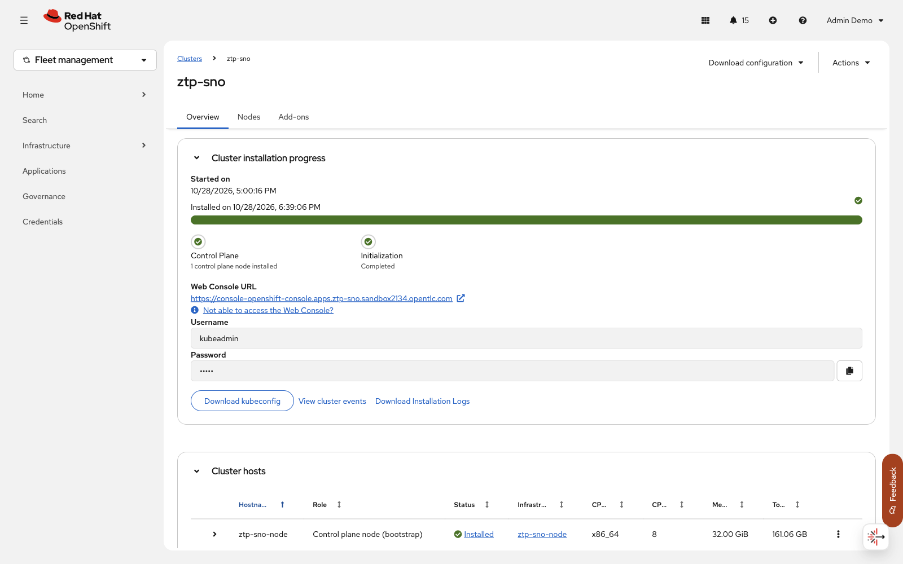

**Show:** open the precreated ZTP site from the fleet and point to the installed node and cluster status.

ACM Clusters → `$ZTP_CLUSTER` → Overview. Show availability, release, node count and identity.

**Say:** “A full install takes longer than this segment, so we created this site beforehand.
This is the real completed cluster. We are not starting an installation or waiting for one.”

### Step 4 — SOURCE / TERMINAL: show the intent used to build it · 05:30–07:30

Open the reviewed chart and safe fields from the precreated local site values. Then inspect
selected fields of the actual ClusterInstance:

```bash
oc_hub get clusterinstance "$ZTP_CLUSTER" -n "$ZTP_CLUSTER" -o json |
  jq '{site:.spec.clusterName,release:.spec.clusterImageSetNameRef,templates:.spec.templateRefs,
       nodes:[.spec.nodes[]|{hostName,role,bootMode,templateRefs}]}'
```

**Say:** “This is the site definition: its name, OpenShift release, templates, and the node to
install. SiteConfig uses the definition and templates to produce the installation resources.
Here there is one control-plane node, so this is single-node OpenShift.”

**Point:** The `ClusterInstance` is the desired site configuration, not the installed cluster
itself. Helm rendered it in this lab; credentials are referenced, not displayed. If the
creation was Helm-driven, say so; show Argo sync history only if Argo was the actual owner.

### Step 5 — TERMINAL: follow the generated resources · 07:30–09:30

```bash
oc_hub get clusterinstance "$ZTP_CLUSTER" -n "$ZTP_CLUSTER" -o json |
  jq -r '.status.conditions[] | [.type,.status,.reason] | @tsv'
oc_hub get agentclusterinstalls,infraenvs,baremetalhosts -n "$ZTP_CLUSTER"
```

**Say:** “The site definition leads to several cooperating resources. `InfraEnv` supplied the
discovery environment. `BareMetalHost` represents the machine and its management interface.
`AgentClusterInstall` holds and tracks installation details. Together they connect the desired
site to the machine that gets installed.”

**Point:** SiteConfig validation and template rendering are separate from the actual install.
The conditions and resources shown are retained results; they are not live installation progress.

### Step 6 — CONSOLE: explain the VM/BMC path · 09:30–12:00

Virtualization → VirtualMachines → `$ZTP_VM` in `$ZTP_CLUSTER` → Overview/Details. Point to the
running installed VM, root disk, resources and network. Brief terminal support:

```bash
oc_hub get virtualmachinebmcs -n "$ZTP_CLUSTER"
oc_hub get agents -n "$ZTP_CLUSTER"
```

**Explain:** the VM substituted for hardware; the BMC exposed Redfish power/media control;
discovery reported inventory; Assisted Installer wrote OpenShift to disk. Describe the actual
prepared boot history, including any manual intervention. Transient media/import resources may
already be gone; do not recreate them. Label genuine preparation captures as such.

**Say:** “At a physical site, a baseboard management controller, or BMC, can provide remote
power and boot-media control. Here a virtual machine and virtual BMC play those roles. The
discovery environment identifies the host and checks its readiness before installation.”

### Step 7 — CONSOLE / TERMINAL: distinguish the three health layers · 12:00–16:00

Return to ACM site Overview / Nodes, then:

```bash
oc_hub get managedcluster "$ZTP_CLUSTER"
oc_ztp get nodes
oc_ztp get clusteroperators
```

**Point:** VM Running, guest node/operators healthy, ACM accepted/joined/available. Use the
installed site's context for guest checks, not the hub's node view.

**Say:** “These are three different questions: is the machine running, is OpenShift healthy
inside it, and can ACM manage the cluster? A green VM alone does not answer the other two.”

**Transition:** “That explains the lifecycle behind our precreated site. Once a cluster is
available, how do we keep it aligned with the baseline?” Switch to Governance.

**No lifecycle mutations:** no `prereqs.sh --apply`, infrastructure Helm updates, hold toggles,
ISO insertion, VM power actions, reinstallation, or progress watches in this act.

## Pillar 3 — organise the fleet with cluster sets · 16:00–24:00

Before we apply a common policy, we need to decide which clusters a team can select. A
`ManagedClusterSet` groups managed clusters for administration and selection. A
`ManagedClusterSetBinding` makes a set available in a particular hub namespace; access to
that namespace and the set still depends on the configured permissions. A `Placement` in that
namespace selects from the bound set or sets, using criteria such as cluster labels. Its
`PlacementDecision` records the resulting targets. A `PlacementBinding` then connects a policy
or policy set to the placement. A cluster set is therefore the selection boundary, while a
placement decides which eligible clusters receive a particular policy or application.

### CONSOLE: create a set and add the three managed clusters

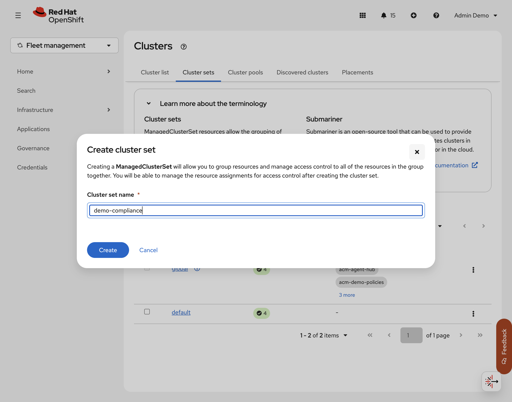

1. In **Infrastructure → Clusters → Cluster sets**, select **Create cluster set**. Enter
   `demo-compliance` and select **Create**. The screenshot shows the form before submission.
2. Open the new set and use **Actions → Manage resource assignments** to assign `cluster1`,
   `cluster2-sno`, and `ztp-sno`. Do not add `local-cluster`. Confirm the three members in
   the **Cluster list** tab. Select **Review** and **Save** when prompted. Moving clusters
   requires permission on both their current set and the new set. Menu names can vary with the
   console version and permissions.
3. Create the hub namespace `acm-demo-compliance` in the OpenShift console if it does not
   exist. In the cluster set's **Actions → Edit namespace bindings**, bind the set to that
   namespace. This enables placements in the namespace to select its members.

With exclusive cluster-set membership, adding the clusters moves them from their previous set.
The built-in `global` set still includes them, but placements restricted to an old set can lose
targets. Check the recorded memberships and existing placements before doing this; if a move
would disrupt the prepared demo, resolve the placement configuration backstage first. After the
exercise, restore the recorded membership and verify the original placements.

**Say:** “A cluster set lets us organise the fleet and delegate access. A namespace binding
makes a set available to the team working in that namespace. Placement then narrows the choice:
for example, we might select only clusters with a particular environment label.”

### TERMINAL: follow the selection chain

```bash
oc_hub get managedclustersets
oc_hub get managedclusters -o json | jq -r '.items[] |
  [.metadata.name, (.metadata.labels["cluster.open-cluster-management.io/clusterset"] // "") ] | @tsv'
oc_hub get managedclustersetbindings -n acm-demo-compliance
```

**Point:** The binding makes the new set available in this namespace. In the next section the
new policy's placement selects its members; we will inspect its actual `PlacementDecision`
after creating the policy. Applications and the existing baseline have their own placements and
can select differently.

**Transition:** “We have defined the group we can work with and selected the targets. Now we
can apply a policy to those targets and see the result from the hub.”

## Pillar 4 — governance and policies · 24:00–43:00

### Background for the presenter

Governance means defining the configuration and operational requirements that should apply to
a group of clusters, checking whether they are met, and deciding what to do when they are not.
Examples include requiring an operator or checking a security-related configuration. ACM
reports results centrally, while controllers on managed clusters evaluate the propagated
policies. A `Placement` selects the targets and a `PlacementBinding` connects that selection
to the policy. This lets different environments have different requirements.

Policies can check for required Kubernetes resources and configuration, report compliance,
and, where supported, create or correct resources. For example, a team might require an
operator installation, a namespace configuration, or a particular platform setting. Related
policies can be grouped into a `PolicySet` and placed together. Policy capabilities depend on
the policy type and controller. A policy can support an organisational standard, but a green
result only shows that its defined checks passed; it does not prove complete security or
regulatory compliance.

In **inform** mode, the demonstration policy reports an unexpected or missing configuration.
In **enforce** mode, its configuration policy also attempts to bring that configuration into
line. The example uses a harmless ConfigMap so the audience can see a change safely; it is a
teaching aid, not a complete security control or a compliance certification. Enforcement
depends on the policy and controller; do not imply every policy can automatically fix every
violation.

**Introduce the act:** “Installing a cluster is only the beginning. We also need to know
whether it follows the standards we agreed on, and whether a later change has moved it away
from those standards. Let's first observe a difference, then let a policy correct it.”

### Step 8 — CONSOLE: inform observes · 24:00–26:00

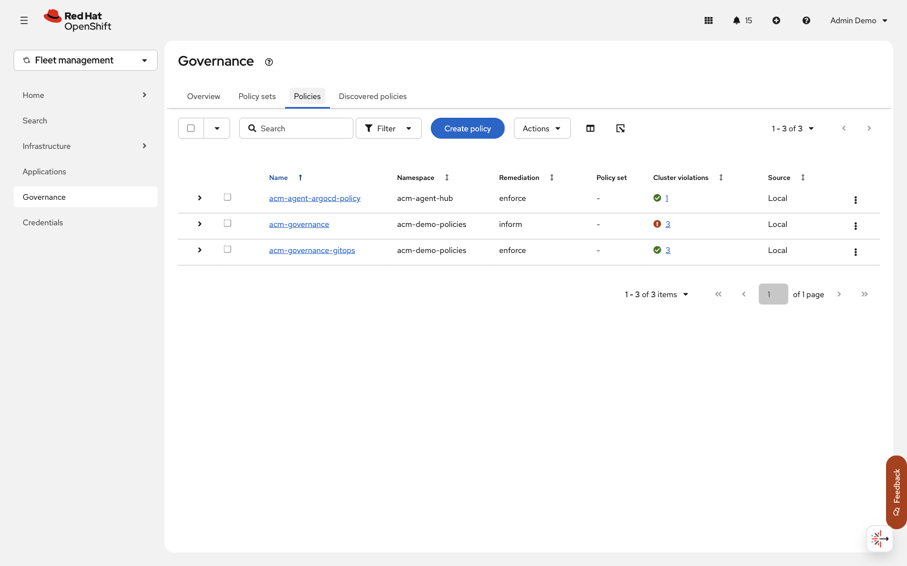

**Show:** Governance → Policies; identify the baseline policy and the GitOps installation
policy. The screenshot is an example; read the current violation counts from the live console.

Governance → `$GOVERNANCE_RELEASE` → Details / cluster compliance. Read one NonCompliant message.
Explain the harmless required ConfigMap value and show which cluster was selected.

**Say:** “The policy describes the baseline we expect. ACM checks it on the selected clusters
and reports the result here. NonCompliant means the observed state does not match the policy;
in inform mode this policy reports the difference without correcting it.”

Also point to the separate OpenShift GitOps operator policy. It enforces the Operator Lifecycle
Manager subscription that requests installation of the operator on the selected clusters. It
is already prepared and compliant; this step shows the policy result, not a live installation.
Policy compliance confirms the policy's defined objects, not by itself that every GitOps
component is healthy. The Argo CD agent add-on and its configuration are separate from that
operator-installation policy.

### Step 9 — TERMINAL: prove selection and lack of correction · 26:00–28:00

```bash
oc_hub get placementdecisions -n "$POLICY_NS" \
  -l "cluster.open-cluster-management.io/placement=$GOVERNANCE_RELEASE" -o json |
  jq -r '.items[].status.decisions[] | .clusterName'
oc_prod get configmap demo-security-baseline -n "$BASELINE_NS" --ignore-not-found
```

**Explain:** the three demo-enabled managed clusters are selected; the hub is excluded. Inform reports but does not create/correct the object;
initial absence/NotFound can be expected. Do not claim absence if displaying an existing object.

### Step 10 — ADVANCE / CONSOLE: enforce corrects · 28:00–30:00

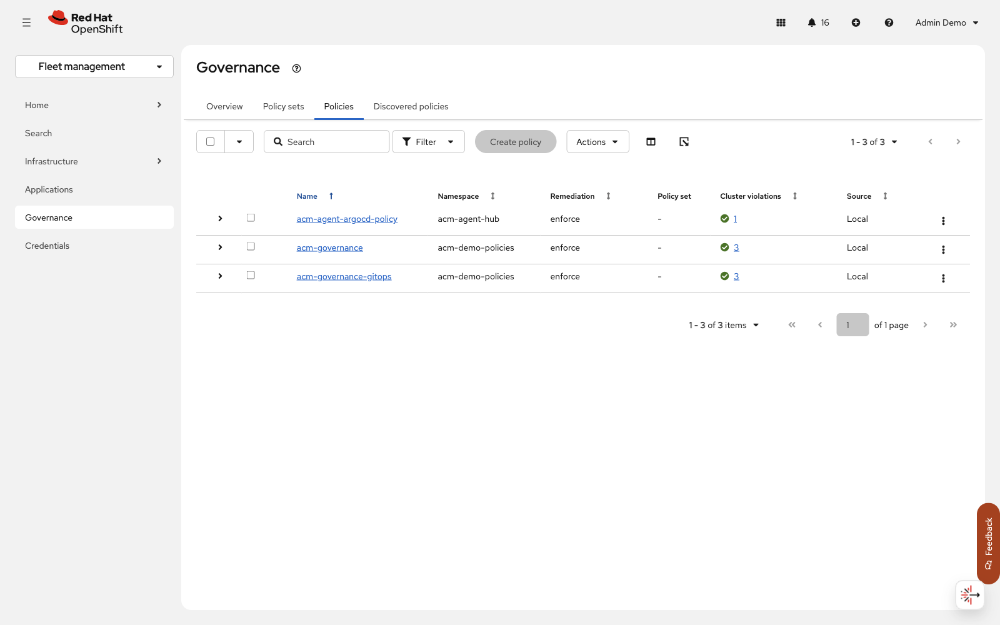

**Show:** the same policy after its terminal Helm upgrade; wait for the three target results to turn compliant.

Using the existing Helm-owned release and prepared local input:

```bash
scripts/setup-demo.sh governance-enforce --apply
oc_hub wait "policy/$GOVERNANCE_RELEASE" -n "$POLICY_NS" \
  --for=jsonpath='{.status.compliant}'=Compliant --timeout=90s
oc_prod get configmap demo-security-baseline -n "$BASELINE_NS" -o json | jq '.data'
```

**Point:** console becomes Compliant; target contains the required value. The definition lives
on the hub; the managed policy controller corrects the target. Parent/embedded remediation
must not conflict. This changes policy intent, not infrastructure.

**Say:** “We changed the policy from reporting to enforcement. The managed-cluster controller
creates or corrects the example configuration, and ACM reports the result back to the hub.”

### Step 11 — ADVANCE / TERMINAL: demonstrate continuous remediation · 30:00–32:00

```bash
scripts/drift-demo.sh --apply
```

Explain the authorized one-field drift in the demo-owned ConfigMap and the restored baseline.
The script checks production identity, asks for confirmation, and bounds the remediation wait.
Do not promise to catch a transient red UI state or measure latency from an immediate wait.

**Say:** “A configuration can change after it was initially correct. This script deliberately
changes one value; the controller then restores the required value. That ongoing comparison is
what we mean by drift detection and remediation.” Follow the script's confirmation prompt and
point to its before-and-after output.

### Step 12 — CONSOLE / TERMINAL: prove exclusion · 32:00–34:00

Show the selected-cluster list and inspect the prepared negative target:

```bash
oc_excluded get namespace "$BASELINE_NS" --ignore-not-found
```

Expect no baseline namespace, or compare its known initial state if it legitimately pre-existed.
**Transition:** “Fleet-wide does not mean every cluster. Now let us create a policy for the
cluster set we just assembled.”

### CONSOLE / TERMINAL: create a Compliance Operator policy · 34:00–43:00

**Purpose:** Show how one policy can install a common capability on a selected group, then
request an assessment on those clusters. The Compliance Operator scans OpenShift against
selected security profiles and records individual check results. A scan result is evidence for
review, not a certification or an automatic guarantee of regulatory compliance.

**Prerequisites:** The new `demo-compliance` set contains the three managed clusters and is
bound to the `acm-demo-compliance` hub namespace. Each target needs access to the Red Hat
Operator catalog, the required images, and storage for scan results. Confirm that the namespace,
operator group, subscription and scan binding in the examples do not conflict with existing
installations. The default `ScanSetting` uses persistent storage and schedules recurring scans;
its default does not automatically apply remediations. Check storage capacity and settings on
each cluster before the presentation. SNO clusters have limited resources; scans can take time.

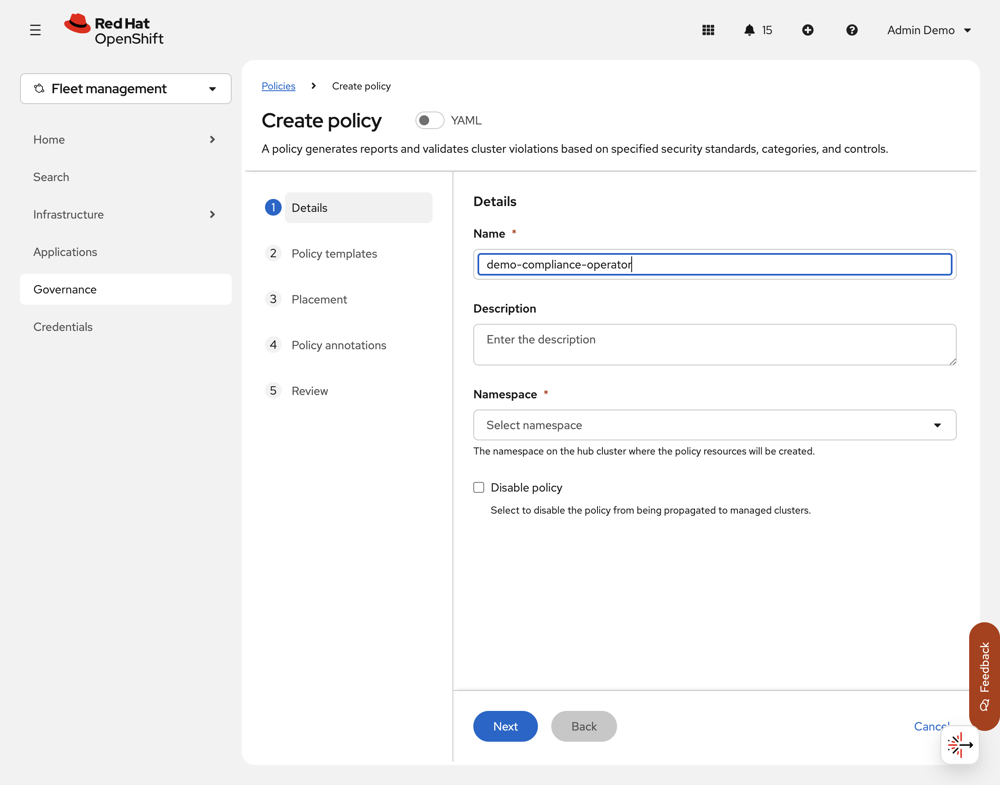

1. Open **Governance → Policies → Create policy**. Switch **YAML** on. The screenshot shows
   the creation form before submission.
2. Copy the complete [operator policy and placement](examples/compliance-operator-policy.yaml)
   into the YAML editor, replacing its generated content. Review the policy name and namespace,
   the namespace/OperatorGroup/OLM Subscription templates, the `demo-compliance` placement,
   and the `PlacementBinding`. Complete the console's review and create the resources.
   The subscription requests the `stable` channel from `redhat-operators`; confirm that source
   and channel are available on each target. Do not change the policy namespace or set name
   without updating the matching placement and binding.

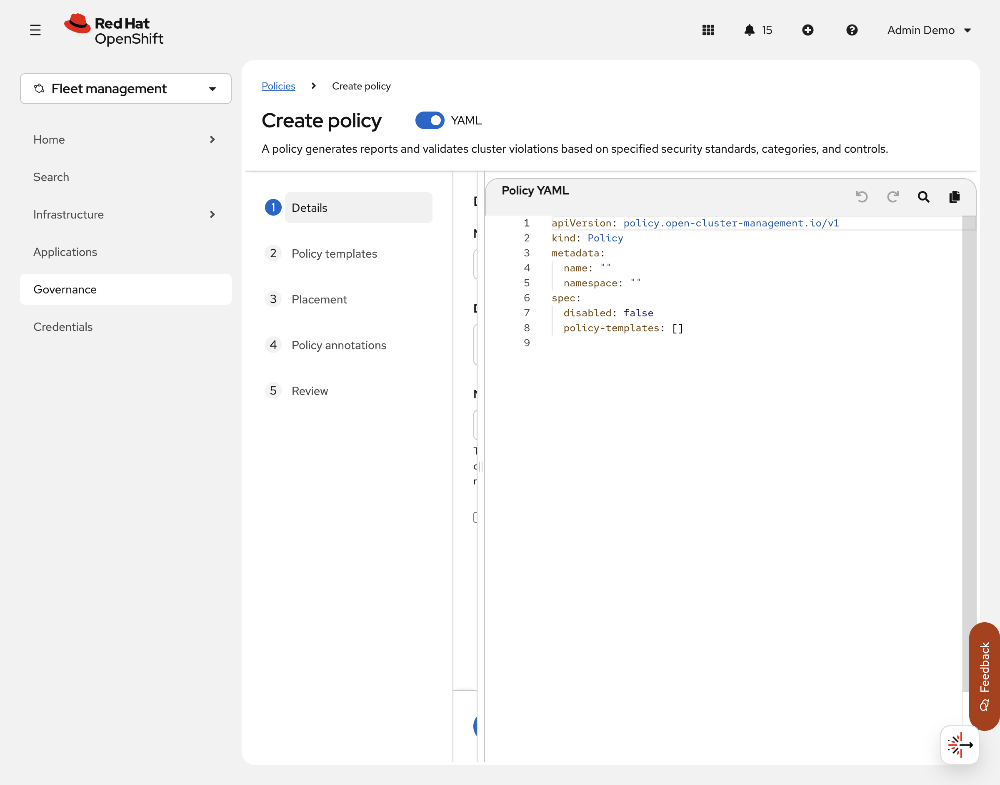

3. In the policy's **Details / Results**, show its placement and per-cluster status. In the
   terminal, check the decisions and installation on the production target:

   ```bash
   oc_hub get placementdecision -n acm-demo-compliance \
     -l cluster.open-cluster-management.io/placement=demo-compliance -o json |
     jq -r '.items[].status.decisions[] | .clusterName'
   oc_prod get csv,deployments -n openshift-compliance
   oc_prod get profile,scansetting -n openshift-compliance
   ```

   Check the other two managed clusters through their own console/API contexts as well. The
   policy result confirms its specified objects; verify that the Compliance Operator CSV is
   `Succeeded`, its deployment is ready, the `default` ScanSetting exists, and the `ocp4-cis`
   profile is available on **each** target before creating the scan policy. If installation is
   still running, show the current progress and return later; do not claim it is complete.

4. Create another policy in the same console using the complete [scan policy](examples/compliance-scan-policy.yaml).
   It reuses the existing placement and creates a `ScanSettingBinding` called
   `demo-platform-cis` on the three targets. Review and create it. This example uses the
   `ocp4-cis` **platform** profile only, so it demonstrates a scan and does not represent a
   complete CIS assessment including node profiles. It uses `default`, not
   `default-auto-apply`; it does not automatically apply scan remediations.
5. Show the new policy's cluster results, then inspect the scan on a target:

   ```bash
   oc_prod get scansettingbinding,compliancesuite,compliancescan -n openshift-compliance
   oc_prod get compliancecheckresults -n openshift-compliance \
     -l compliance.openshift.io/suite=demo-platform-cis
   ```

   Repeat against the other target contexts, or show their actual console results. A policy
   that reports the binding present does **not** mean the scan has finished or passed. Point
   out the suite phase and result, and return to this view during the buffer if scans are still
   running. Do not promise a passing result or apply suggested remediations during the demo.

**Say:** “The cluster set defines the group, the placement selects its members, and policy
ensures the same operator and scan request are present on each selected cluster. The operator
then performs the assessment locally. ACM policy status and the scan's findings answer two
different questions, so we look at both.”

**Transition:** “We have a consistent platform capability and can inspect the results. Next,
let's see how ACM and OpenShift GitOps deliver applications to selected clusters.”

## Pillar 5 — application delivery · 43:00–69:00

Governance and application delivery work together. Policies can establish the platform
baseline—for example, by requesting an OpenShift GitOps Operator installation—while GitOps
manages the desired state of applications and, where appropriate, platform configuration. The
team still needs to decide which controller owns each resource so two systems do not repeatedly
overwrite each other.

### Choose a delivery model

| Model | How intent reaches the target | Where the application is reconciled | What to consider |
| --- | --- | --- | --- |
| **Central push** | The hub Argo CD controller uses credentials and the managed cluster API to apply resources. | Hub | Central visibility and control; the hub needs suitable access to each target and does the reconciliation work. |
| **ACM pull, using ManifestWork** | ACM propagates an Argo `Application` to the selected managed cluster through its hub-to-cluster management channel. | Managed cluster, using its local Argo CD controller | Each target needs local GitOps components and access to the application source. ACM aggregates status; the reporting path differs from agent mode. |
| **Argo CD Agent, managed mode** | A central principal communicates application intent to an agent on the managed cluster. | Managed cluster, using its local Argo CD controller | The principal receives status from the agent; the ACM integration is Technology Preview in 2.17 and needs its own connectivity and configuration. |

Red Hat also describes agent mode as an advanced pull model. Here, “ACM pull” refers specifically
to the separate ManifestWork-based mechanism, so it is clear how its propagation differs from
the agent connection. Both local models need permissions, source access and a working network;
the choice depends on operating and connectivity requirements.

**Say:** “The main question is where the controller runs and how the application definition
gets there. With push, Argo on the hub acts on the remote cluster. With ACM pull, the
application definition is propagated to a local Argo instance. With agent mode, a principal
and an agent exchange the intent and status, and a local controller does the work.”

**What we demonstrate:** the prepared lab includes central push and agent delivery. The
ManifestWork-based Argo pull model is explained for comparison; it is not a separate live
exercise in this runbook. We also show the older ACM application subscription model before the
GitOps examples to give the audience a point of comparison.

### Legacy application subscription · 43:00–50:00

#### Background for the presenter

With the clusters available and a baseline in place, the next question is how to deliver an
application consistently. All three examples use the same demonstration application and show
its version in the browser. Each uses cluster selection and reconciliation, but a different
component is responsible for getting the application to its destination.

ACM application subscription is the older model: a **Channel** identifies a source, a
**Subscription** selects content from that source, and a **Placement** selects target clusters.
It is deprecated in ACM 2.17; Red Hat recommends OpenShift GitOps for application management.
It is included here to explain an existing approach and make the comparison concrete. This
application Subscription is different from the Operator Lifecycle Manager Subscription used
by the GitOps operator policy.

**Introduce the act:** “We will deploy the same small application in three ways. First, let's
look at the older ACM subscription model, then compare it with two Argo CD approaches.”

#### Step 13 — APP: show v1 and request v2 early · 43:00–44:15

Show version/environment/model on the subscription app's real HTTPS page. Position this as the
legacy model deprecated in ACM 2.17—not an OLM operator Subscription. For approved CLI Helm intent:

```bash
"${HELM_HUB[@]}" upgrade "$SUB_RELEASE" "$DEMO_ROOT/charts/delivery" -n "$SUB_NS" \
  -f "$DEMO_VALUES_DIR/subscription.local.yaml" \
  --set-string "subscription.chartVersion=$SUB_V2_CHART_VERSION" \
  --set-string "application.version=$DEMO_V2_VERSION" --wait --timeout 2m
```

This updates the existing intent release. In this lab the managed Subscription retained its old inputs; the verified v2 workaround recreates the demo Subscription as described in [setup](setup.md#subscription-update-workaround). If the workaround has not been performed, show v1 and do not claim v2 has deployed.

**Say:** “We are requesting a new published Helm package for the existing application. The
package version identifies what the subscription retrieves; the application version is what
the user sees. The lab needs a target-side workaround before this particular update takes effect.”

#### Step 14 — CONSOLE / TERMINAL: source, selection, destination · 44:15–47:30

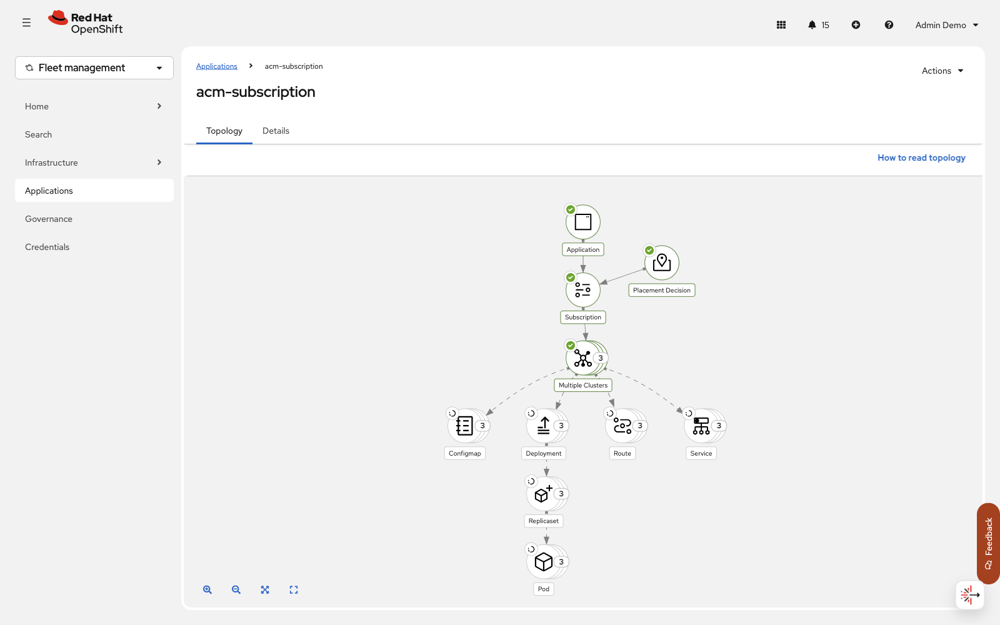

**Show:** Applications → `acm-subscription` → Topology; trace Subscription → Placement → three clusters → workload.

ACM Applications → `$SUB_RELEASE` in `$SUB_NS` → Topology. Point to Channel, Subscription,
placement/target, delivered workload. Then:

```bash
oc_hub get subscriptions.apps.open-cluster-management.io "$SUB_RELEASE" -n "$SUB_NS" -o json |
  jq '{chart:.spec.name,packageVersion:.spec.packageFilter.version,
       placement:.spec.placement.placementRef,phase:.status.phase}'
oc_prod get deployment "$SUB_DEPLOYMENT" -n "$SUB_NS"
```

**Explain:** Channel says where, Subscription says what, Placement says which clusters.
A package version request or hub phase alone is not proof of the application response.

**Say:** “Read the topology from left to right: where the package comes from, what is selected,
which clusters receive it, and the resulting workload. This view connects our central request
to the things running on each selected cluster.”

#### Step 15 — APP: prove v2 · 47:30–50:00


```bash
oc_prod get route "$SUB_ROUTE" -n "$SUB_NS" -o jsonpath='https://{.spec.host}{"\n"}'
```

Hard-refresh the actual HTTPS page and point to v2, unchanged environment, subscription model. In this lab, the managed Subscription must be recreated after the version change; follow the tested [terminal procedure](setup.md#subscription-update-workaround), then update `$SUB_DEPLOYMENT` and `$SUB_ROUTE` to the newly generated names. This briefly interrupts the demo workload. If it has not completed, show the actual current version and revisit it later.

**Transition:** “Same app and fleet selection; now let central Argo perform reconciliation.”

### Central Argo push · 50:00–59:00

#### Background for the presenter

GitOps uses a declared desired state, typically stored and reviewed in Git, and a controller
that compares it with the deployed state. Argo CD can render a Helm chart from Git and apply the
result to a destination cluster. ACM placement and `GitOpsCluster` connect the chosen managed
clusters to Argo; an `ApplicationSet` creates the per-destination Argo `Application` objects.
In this model the application controller on the hub contacts the remote cluster API and does
the reconciliation centrally. Access, permissions and network connectivity are required.

The application chart comes from Git, but the version update shown below changes an existing
CLI Helm-owned delivery release. It demonstrates reconciliation, not a Git commit or a
Git-driven change approval workflow.

**Introduce the act:** “Now the application stays the same, but Argo CD takes responsibility
for keeping it in the requested state. In this first Argo example, the controller runs centrally
and reaches out to the selected clusters.”

#### Step 16 — ARGO / TERMINAL: explain the control loop · 50:00–53:30

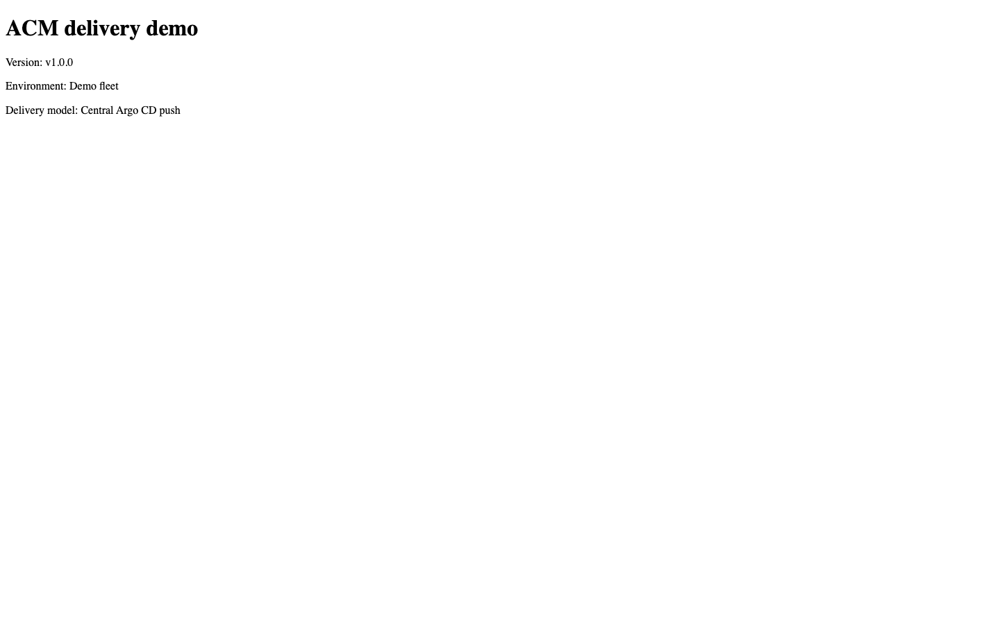

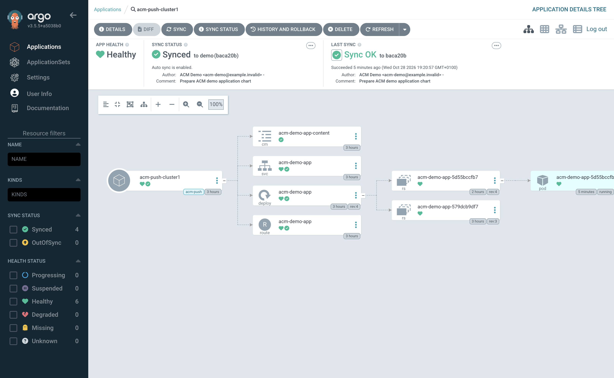

**Show:** central Argo → `$PUSH_APP`; point to Synced, Healthy, and the Deployment, Service and Route.

Central Argo → `$PUSH_APP` → Details / tree. Show v1 source, registered destination, Synced/Healthy
and actual app page. Trace the target decision and generator:

```bash
oc_hub get placementdecisions -n "$CENTRAL_NS" \
  -l "cluster.open-cluster-management.io/placement=$PUSH_RELEASE" -o json |
  jq -r '.items[].status.decisions[] | .clusterName'
oc_hub get gitopscluster "$PUSH_RELEASE" -n "$CENTRAL_NS"
oc_hub get applicationset "$PUSH_RELEASE" -n "$CENTRAL_NS" -o json |
  jq '{generator:.spec.generators,path:.spec.template.spec.source.path,
       destination:.spec.template.spec.destination}'
```

**Explain:** ACM selects/integrates the cluster, ApplicationSet generates an Application,
and the **central** application-controller reconciles the remote API. Argo renders the Helm
chart; don't install a separate Helm owner on those target objects. No registration Secret dump.

**Say:** “Placement chooses the destinations. The ApplicationSet creates the Argo application
for each destination. Argo reads the chart, compares the result with the remote cluster, and
reconciles any difference. Synced describes the comparison; Healthy describes the reported
health of the resources. We will also check the actual application response.”

#### Step 17 — ADVANCE / ARGO: reuse the local input for v2 · 53:30–55:30

```bash
"${HELM_HUB[@]}" upgrade "$PUSH_RELEASE" "$DEMO_ROOT/charts/delivery" -n "$CENTRAL_NS" \
  -f "$DEMO_VALUES_DIR/push.local.yaml" \
  --set-string "application.version=$DEMO_V2_VERSION" --wait --timeout 2m
```

Show the generated Application's updated Helm input and sync result/history. No manual edits
to its Deployment or generated Application. If sync is fast, use its history instead of forcing
another update to catch OutOfSync on screen.

**Say:** “We change the requested version once in the delivery configuration. The central Argo
controller observes the resulting application definition and applies the update to its target.”

#### Step 18 — TERMINAL / APP: prove remote rollout · 55:30–59:00


```bash
oc_prod rollout status "deployment/$APP_RELEASE" -n "$PUSH_NS" --timeout=90s
oc_hub get applications.argoproj.io "$PUSH_APP" -n "$CENTRAL_NS" -o json |
  jq '{sync:.status.sync.status,health:.status.health.status}'
oc_prod get route "$APP_RELEASE" -n "$PUSH_NS" -o jsonpath='https://{.spec.host}{"\n"}'
```

Hard-refresh the push app: v2 / production / central push. Explain that the chart's content
checksum drives a pod-template change, not just a stored ConfigMap update.

**Transition:** “Keep central intent, but move application reconciliation onto the target.”

### Argo CD Agent managed mode · 59:00–69:00

#### Background for the presenter

The agent model separates central application intent from reconciliation at the managed
cluster. A central **principal** communicates with an agent at the target; a local Argo CD
application controller reconciles the application there and status is returned to the principal.
This changes the controller location and connection pattern, which can be relevant when
designing network access and operational boundaries. It does not remove the need for
connectivity, authentication, permissions, or source access.

The ACM integration with Argo CD Agent is **Technology Preview in ACM 2.17**. This lab uses a
separate principal Argo instance from the central push instance. Its agent example targets the
prepared agent cluster; do not imply it is running on all three targets unless the live
placement and results show that.

**Introduce the act:** “What if we want the application controller closer to the workload?
We can still define the request centrally, but let a controller on the managed cluster apply it
and report the result back.”

#### Step 19 — PRINCIPAL / TERMINAL: show both sides · 59:00–64:00

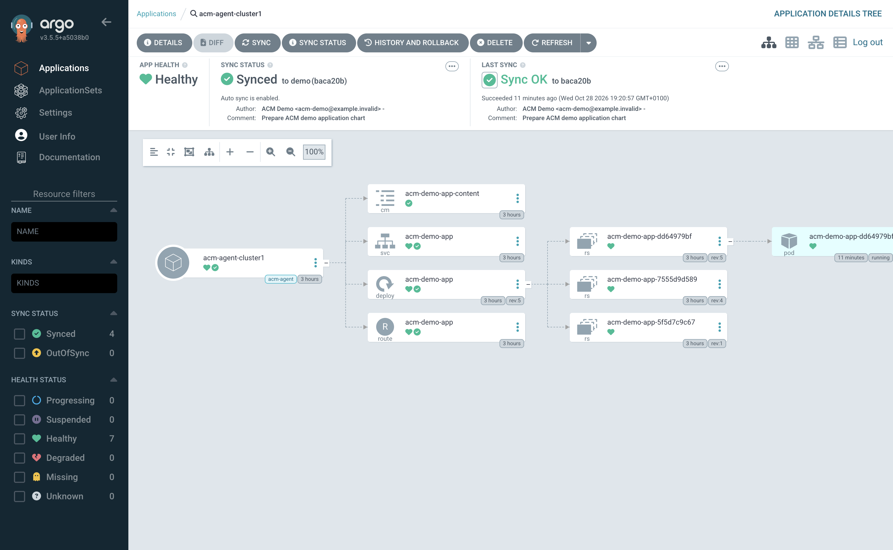

**Show:** the separate agent-principal Argo console → `$AGENT_APP`; compare its returned status with the managed-cluster objects in the terminal.

Open the **separate principal Argo console** using the `agent-principal-server` route from the
preparation step, then select `$AGENT_APP`. It will not appear in the central push console.
Show the source and v1 intent, then inspect the prepared managed target:

```bash
oc_hub get gitopscluster "$AGENT_RELEASE" -n "$PRINCIPAL_NS" -o json |
  jq '{principal:.spec.argoServer,agent:.spec.gitopsAddon.argoCDAgent}'
oc_hub get managedclusteraddons -n "$AGENT_CLUSTER"
oc_agent get deployments -n "$AGENT_GITOPS_NS"
oc_agent get applications.argoproj.io "$LOCAL_AGENT_APP" -n "$AGENT_GITOPS_NS" -o json |
  jq '{name:.metadata.name,destination:.spec.destination,
       sync:.status.sync.status,health:.status.health.status}'
```

**Explain:** principal holds central intent; managed agent/local application-controller performs
application reconciliation. A Ready Deployment or destination name alone is not connection proof.
Use the actual rehearsed connection-status signal, then demonstrate the v2/status round trip.
The ACM integration is Technology Preview in 2.17, separate from ManifestWork application pull.

**Say:** “The principal is our central view. On the managed cluster, the agent receives the
application intent and the local application controller reconciles it. We will check both the
local rollout and the status returned to the principal.”

#### Step 20 — ADVANCE: change principal intent with existing values · 64:00–65:00

```bash
"${HELM_HUB[@]}" upgrade "$AGENT_RELEASE" "$DEMO_ROOT/charts/delivery" -n "$PRINCIPAL_NS" \
  -f "$DEMO_VALUES_DIR/agent.local.yaml" \
  --set-string "application.version=$DEMO_V2_VERSION" --wait --timeout 2m
```

**Say:** “We request the version centrally. We are not patching the remote Deployment to simulate
agent delivery.” Keep push and agent principal instances visibly separate.

#### Step 21 — TERMINAL / APP / PRINCIPAL: prove the round trip · 65:00–69:00

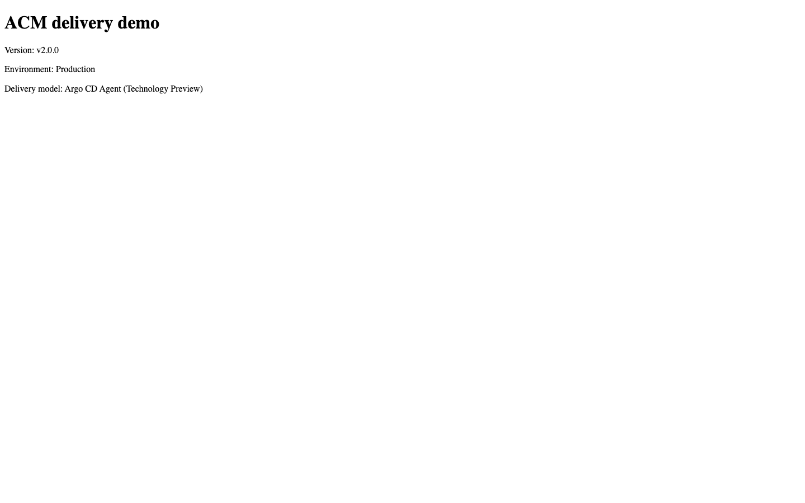

```bash
oc_agent rollout status "deployment/$APP_RELEASE" -n "$AGENT_APP_NS" --timeout=90s
oc_agent get applications.argoproj.io "$LOCAL_AGENT_APP" -n "$AGENT_GITOPS_NS" -o json |
  jq '{sync:.status.sync.status,health:.status.health.status}'
oc_agent get route "$APP_RELEASE" -n "$AGENT_APP_NS" -o jsonpath='https://{.spec.host}{"\n"}'
oc_hub get applications.argoproj.io "$AGENT_APP" -n "$PRINCIPAL_NS" -o json |
  jq '{sync:.status.sync.status,health:.status.health.status}'
```

Show the actual v2 HTTPS response, then return to the principal's current status.
**Land:** “Central intent, local reconciliation, central visibility.” Do not imply zero
credentials, no network dependencies, unlimited scale, or new updates working disconnected.

## Close — 69:00–72:00

Return to the precreated site's ACM availability as a recap—not a claim it finished during
the talk. Compare the three control loops:

| Question | Subscription | Central push | ACM pull with ManifestWork | Agent managed mode |
| --- | --- | --- | --- | --- |
| Central intent | Channel / Subscription | ApplicationSet / Application | ApplicationSet / Application | Principal ApplicationSet / Application |
| App reconciliation | Subscription machinery | Central application-controller | Managed-cluster application-controller | Managed-cluster application-controller |
| Source | Versioned Helm package | Helm chart in Git | Source accessed by local Argo | Same Helm chart in Git |
| Shown today | Workload and response | Central status + remote rollout/response | Architecture explanation only | Local rollout/response + returned principal status |
| Positioning | Legacy / deprecated in ACM 2.17 | Integrated push pattern | Separate ACM pull mechanism | ACM integration Technology Preview in 2.17 |

**Say:** “We kept the application constant in the live examples. What changed was controller
location, permissions, network path, and status return. Lifecycle gives us a cluster; cluster
sets help organise the fleet; governance maintains a baseline; application delivery manages
what runs on it.” Leave the comparison visible for the buffer.

## After the audience leaves

Restore v1/inform through the same owner, using the unchanged base local files and
[reset guidance](reset.md). Never uninstall prerequisite releases, delete cluster namespaces,
reinstall the ZTP site, or destroy cloud infrastructure as routine demo reset.

For the new exercise, first delete or disable the two demo compliance policies so they cannot
recreate target resources. Remove the demo `ScanSettingBinding` from each target to stop its
recurring suite, then clean up only the Compliance Operator resources and scan storage that were
created for this exercise, using the recorded pre-demo inventory to protect existing resources.
The example policies use `pruneObjectBehavior: None`, so deleting the policies alone does not
remove those resources. Do not delete an existing compliance namespace, operator, PVC or scan
owned by another team. Restore each cluster's recorded set membership, verify the original
policy and application placement decisions, and remove the now-unused demo placement,
namespace binding, set and hub namespace if they were created for the exercise. Keep all three
clusters running. Confirm that applications and policy status return to the agreed baseline.

Detailed speaking notes remain available for [lifecycle](runbooks/01-lifecycle-ztp.md),
[governance](runbooks/02-governance.md), [subscription](runbooks/03-app-subscriptions.md),
[push](runbooks/04-app-argocd-push.md), and [agent](runbooks/05-app-argocd-agent.md).

## Further reading

- [ACM 2.17 cluster management and ZTP](https://docs.redhat.com/en/documentation/red_hat_advanced_cluster_management_for_kubernetes/2.17/html-single/clusters/index) and [SiteConfig and ClusterInstance](https://docs.redhat.com/en/documentation/red_hat_advanced_cluster_management_for_kubernetes/2.17/html-single/multicluster_engine_operator_with_red_hat_advanced_cluster_management/index) describe the provisioning components.
- [ACM 2.17 policy deployment and governance architecture](https://docs.redhat.com/en/documentation/red_hat_advanced_cluster_management_for_kubernetes/2.17/html/governance/policy-deployment) explains policy propagation, placement and compliance reporting.
- [OpenShift 4.22 Compliance Operator](https://docs.redhat.com/en/documentation/openshift_container_platform/4.22/html/security_and_compliance/compliance-operator) describes installation, profiles, scan settings and scan results.
- [ACM 2.17 GitOps](https://docs.redhat.com/en/documentation/red_hat_advanced_cluster_management_for_kubernetes/2.17/html/gitops/gitops-overview) explains the GitOps integration and agent Technology Preview. [ACM 2.17 release notes](https://docs.redhat.com/en/documentation/red_hat_advanced_cluster_management_for_kubernetes/2.17/html/release_notes/acm-release-notes) list deprecations, including application subscription.
